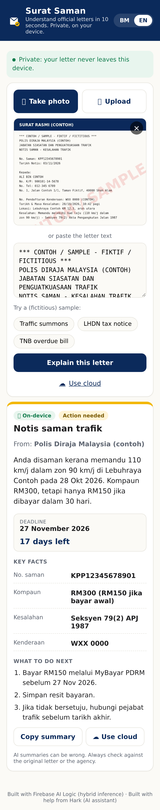
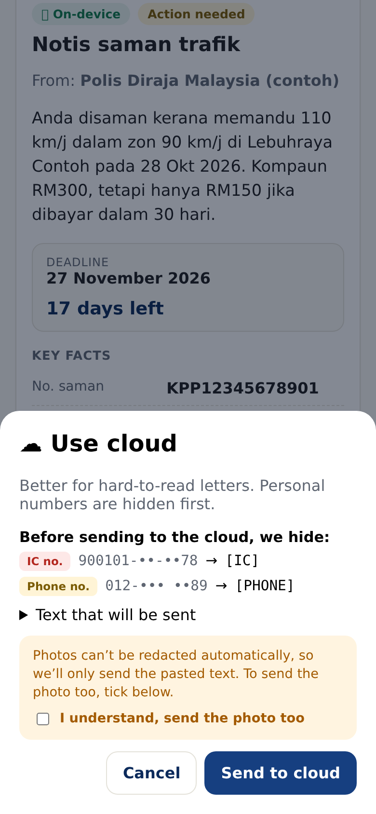
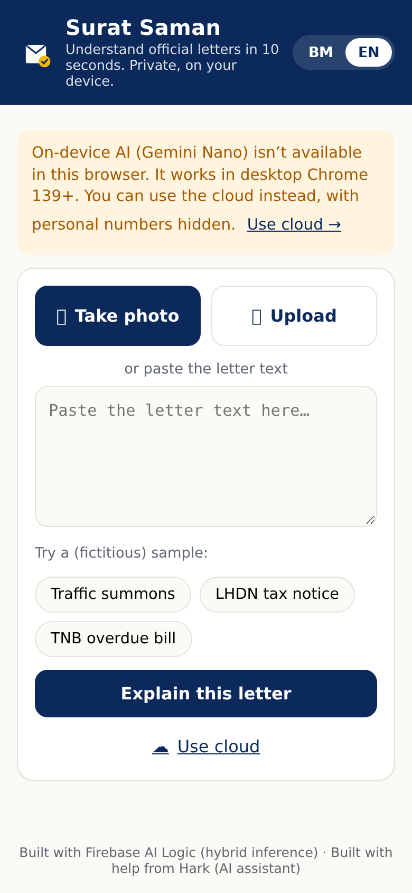

# Surat Saman 📮 — faham surat rasmi dalam 10 saat

**Snap a photo of an official Malaysian letter and get a plain-language explanation in Bahasa Melayu or English: what it is, who sent it, the key facts, the deadline (with days left) and exactly what to do next. Private by default: the AI runs on your device.**

Built for Google's **#BuildHybridAI 2026** hackathon with **Firebase AI Logic hybrid inference** (Gemini Nano on-device + Gemini in the cloud).

| On-device result | Cloud consent + redaction | No on-device model |
|---|---|---|
|  |  |  |

<sub>Screenshots were captured from the production build with the model responses stubbed (see `scripts/e2e/`), using the fictitious sample letters.</sub>

## The problem

Millions of Malaysians receive letters they find hard to read: an LHDN tax assessment, a PDRM/JPJ saman, a TNB arrears notice, a bank or council letter. They are dense, formal and often bilingual, and missing the deadline costs money (a compound that doubles after 30 days, a 10% tax penalty, electricity cut off). Older people, B40 households and non-native readers are hit hardest, and the usual fix — "snap it and ask a chatbot" — means uploading a document full of your **IC number, phone number and account numbers** to a server.

Surat Saman explains the letter **without the letter leaving your phone or laptop**.

## How hybrid inference is used

```
             ┌─────────────── your device ────────────────┐
 photo/text ─┤ Gemini Nano (Chrome Prompt API)             │──► summary + 🔒 On-device badge
             │  via Firebase AI Logic  PREFER_ON_DEVICE    │
             │                                             │
 tap "Use    │ redact() IC / phone / account numbers  ─────┼──► Gemini (cloud) ONLY_IN_CLOUD
  cloud"  ───┤ user reviews what is hidden, photo opt-in   │    └─► summary + ☁ Cloud badge
             └─────────────────────────────────────────────┘
```

1. **On-device first** (`src/ai.ts`). `getGenerativeModel(ai, { mode: InferenceMode.PREFER_ON_DEVICE, onDeviceParams, inCloudParams })` with the Gemini Developer API backend (`GoogleAIBackend`). Image + text input go to Gemini Nano through the Chrome Prompt API. `initializeDeviceModel()` is called on the user's tap and shows download progress.
2. **No silent cloud fallback.** `PREFER_ON_DEVICE` normally falls back to the cloud when Nano isn't ready. For a privacy app that would leak an un-redacted letter, so the app checks `LanguageModel.availability()` (with the same create options the SDK uses) and only calls the hybrid model when the answer is `available`. Otherwise it explains why and offers the cloud.
3. **Cloud only on tap, after on-device redaction** (`src/redact.ts`). A second model with `InferenceMode.ONLY_IN_CLOUD` is used only when the user taps **Use cloud**. Before that, the text is redacted locally:
   - Malaysian IC numbers `######-##-####`, with or without dashes/spaces (12-digit runs only count as IC if they start with a valid YYMMDD, so a TNB account number isn't mislabelled),
   - phone numbers `01x-xxxxxxx` / `+60…` (mobile and landline),
   - account numbers with more than 8 digits (plain or grouped `1234 5678 9012`).
   Reference numbers glued to letters (e.g. saman no. `KPP12345678901`), amounts and dates are kept, because they are what the user needs. The sheet shows each hidden value (masked: `900101-••-••78 → [IC]`) and the exact text that will be sent.
   **Photos can't be redacted**, so they are never sent to the cloud unless the user ticks *"I understand, send the photo too"*; if pasted text is available only the redacted text goes.
4. **Proof of where it ran.** Every result shows a **🔒 On-device** or **☁ Cloud** badge read from the SDK's `response.inferenceSource` (`on_device` / `in_cloud`), not from the app's own guess.
5. **Same structured output on both paths** (`src/schema.ts`). One `Schema.object(...)` is passed as `onDeviceParams.promptOptions.responseConstraint` (on-device) and as `inCloudParams.generationConfig.responseSchema` with `responseMimeType: "application/json"` (cloud). Fields: `letter_type, sender, summary, key_facts[{label,value}], deadline, days_left, next_steps[], urgency (low|medium|high), language (ms|en)`.
6. **Deterministic post-processing** (`src/parse.ts`, `src/deadline.ts`). The JSON is validated; `days_left` is **recomputed on-device** from the deadline in Malaysia time (models are bad at date maths) and urgency is raised automatically when the deadline is ≤ 7 days away.

Other details: installable **PWA** (manifest, maskable icons, service worker that caches the app shell so on-device mode works offline; AI calls are never cached), **BM/EN toggle** (UI + output language), camera capture (`capture="environment"`), photos are normalised to JPEG and downscaled on-device (Nano accepts PNG/JPEG only and has a ~9k token budget), 3 **fictitious sample letters** (text + rendered images).

## Setup

Requirements: Node 20.19+ (tested on 22), a Firebase project (Spark/free plan is fine).

1. **Firebase AI Logic.** Firebase console → *AI Services → AI Logic* → **Get started** → choose **Gemini Developer API**. This also enforces App Check for AI Logic (App Check is required for AI Logic from 2 Nov 2026).
2. **Register the web app** (*Project settings → Your apps → Web*) and copy its config.
3. **Env vars.** `cp .env.example .env.local` and fill in:

   | Variable | Required | What |
   |---|---|---|
   | `VITE_FIREBASE_API_KEY` | yes | Web app config |
   | `VITE_FIREBASE_AUTH_DOMAIN` | yes | e.g. `surat-saman.firebaseapp.com` |
   | `VITE_FIREBASE_PROJECT_ID` | yes | `surat-saman` |
   | `VITE_FIREBASE_STORAGE_BUCKET` | no | `surat-saman.firebasestorage.app` |
   | `VITE_FIREBASE_MESSAGING_SENDER_ID` | no | Web app config |
   | `VITE_FIREBASE_APP_ID` | yes | Web app config |
   | `VITE_RECAPTCHA_SITE_KEY` | prod | reCAPTCHA Enterprise site key for App Check |
   | `VITE_APPCHECK_PROVIDER` | no | `enterprise` (default) or `v3` |
   | `VITE_APPCHECK_DEBUG_TOKEN` | dev | App Check debug token, or `true` to generate one. Only used by `npm run dev`; never inlined into production builds |
   | `VITE_CLOUD_MODEL` | no | Cloud model, default `gemini-3.5-flash-lite` |

4. **App Check for local dev.** Set `VITE_APPCHECK_DEBUG_TOKEN=true`, run `npm run dev`, open the app, copy the `AppCheck debug token: "…"` line from the browser console, register it in *Security → App Check → Apps → ⋮ → Manage debug tokens*, then paste it into `.env.local`. Don't add `localhost` to reCAPTCHA's allowed domains.
5. **App Check for production.** Create a reCAPTCHA Enterprise key for your hosting domain(s), register the web app with the reCAPTCHA Enterprise provider in *App Check → Apps*, and set `VITE_RECAPTCHA_SITE_KEY`.
6. **On-device model (Chrome desktop 139+).** Enable `chrome://flags/#prompt-api-for-gemini-nano-multimodal-input`, restart Chrome. The first tap on *Explain this letter* downloads Gemini Nano (several minutes, progress shown). In other browsers the app explains this and offers the cloud.

```bash
npm install
npm run dev        # http://localhost:5173
npm test           # vitest: redaction, deadline/days-left, output parsing
npm run build      # type-check + production build to dist/
npm run samples    # re-render the fictitious sample letter images (ImageMagick)
npm run icons      # re-generate PWA icons (ImageMagick)
```

### Deploy to Firebase Hosting

```bash
npm i -g firebase-tools
firebase login
npm run build
firebase deploy --only hosting     # uses .firebaserc → project "surat-saman", serves dist/
```
Then add the hosting domain (`surat-saman.web.app`) to the reCAPTCHA key's allowed domains.

## Project layout

```
src/ai.ts              Firebase AI Logic: hybrid model, cloud model, device readiness
src/firebase-config.ts Firebase + App Check init from VITE_ env vars (placeholders)
src/redact.ts          IC / phone / account-number redaction
src/deadline.ts        Malaysia-time deadline + days-left + urgency
src/parse.ts           Model JSON → validated LetterAnalysis
src/schema.ts          Shared responseSchema / responseConstraint
src/main.ts            UI (mobile-first, BM/EN)
samples/*.txt          Fictitious sample letters (text); images in public/samples/
public/sw.js           Offline app-shell service worker
tests/                 Vitest unit tests
scripts/e2e/           Playwright smoke tests (stubbed Prompt API / intercepted Gemini endpoint)
```

## Privacy & safety notes

- All sample letters are **fictitious** (`ALI BIN CONTOH`, IC `900101-14-5678`, phone `012-345 6789`). Never commit real letters.
- Redaction is pattern-based and can miss unusual formats; the user always sees the exact text before it is sent.
- Names and addresses are not redacted (they're needed to explain who the letter is for); that's stated in the review sheet via the preview of the exact outgoing text.
- AI summaries can be wrong; the app always tells users to check against the original letter or the agency.

---

Built with help from Hark (AI assistant).
